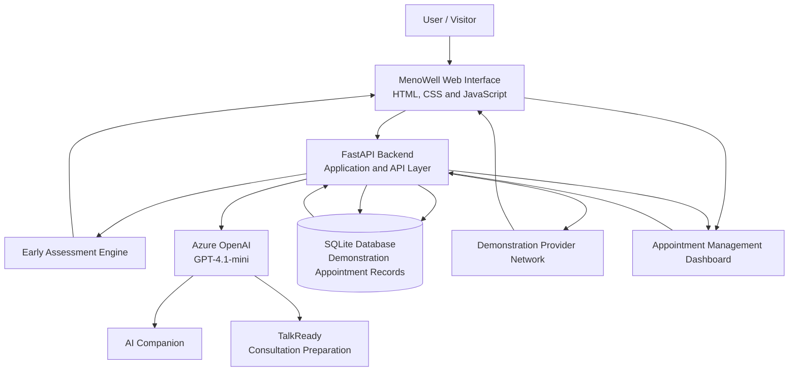
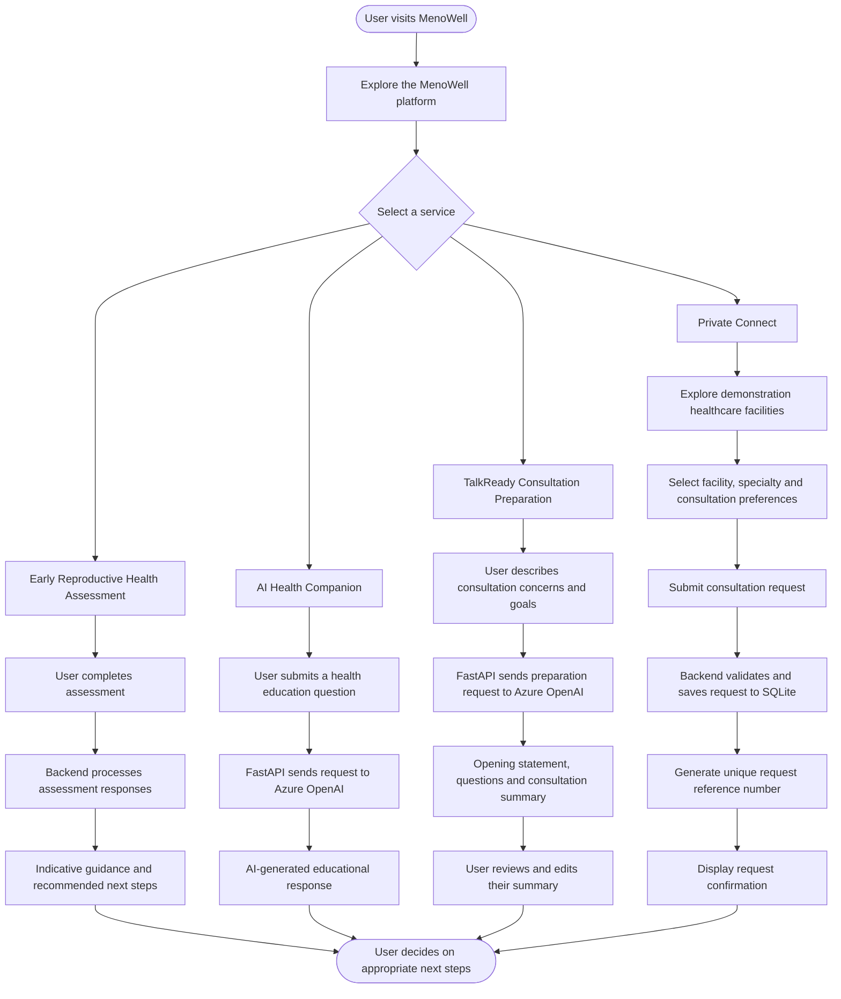
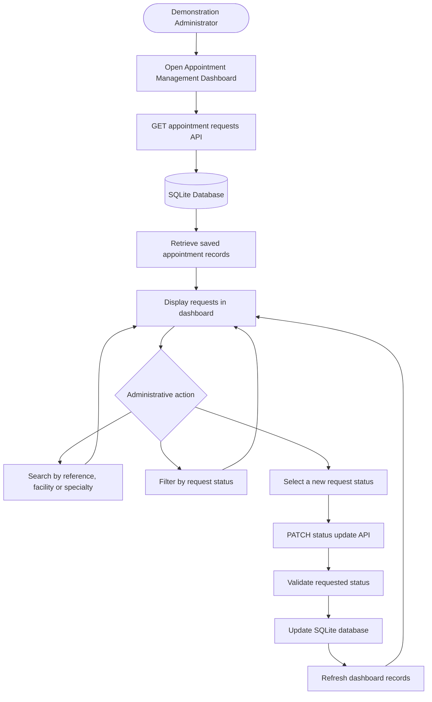

# MenoWell
### Private support. Informed choices. Healthier futures.

**An AI-enabled male reproductive health early-assessment and preconception support platform.**

## 1. Project Overview

MenoWell is a digital health prototype designed to help men access respectful, private and informed reproductive health support.

The platform addresses barriers that can prevent men from seeking early reproductive healthcare, including limited awareness, uncertainty about when to seek professional support, embarrassment and difficulty initiating conversations with healthcare professionals.

MenoWell provides an accessible digital entry point through which users can explore reproductive health information, complete an early assessment, prepare for a clinical consultation and explore demonstration healthcare-provider options.

The platform is designed to support informed healthcare decisions, not replace qualified healthcare professionals.

## 2. Problem Being Addressed

Male reproductive health and preconception wellbeing are important components of reproductive healthcare. However, men may delay seeking support because of:

- Limited awareness of reproductive health and preconception wellbeing.
- Social and cultural barriers surrounding sensitive health discussions.
- Uncertainty about symptoms and when professional assessment may be appropriate.
- Difficulty discussing personal concerns with healthcare professionals.
- Limited access to discreet and user-centred support pathways.

MenoWell aims to address these challenges through private, accessible and culturally sensitive digital support.

## 3. Proposed Solution

MenoWell combines early assessment, AI-assisted health education, consultation preparation and a demonstration provider-request workflow.

### Core Features

**A. Early Reproductive Health Assessment**

Users complete an initial assessment covering their goals, concerns and selected symptoms or risk factors.

The system provides an indicative guidance pathway, including:

- General health information.
- Routine clinical discussion.
- Prompt clinical review.
- Urgent attention for selected warning signs.

The assessment is an early guidance tool and does not establish a medical diagnosis.

**B. MenoWell AI Companion**

An AI-powered educational companion that helps users understand general reproductive health and preconception topics.

The AI Companion is designed to provide accessible, respectful information while avoiding diagnosis, autonomous clinical interpretation and prescribing.

**C. MenoWell TalkReady**

A consultation-preparation feature that helps users:

- Organise their health concerns.
- Prepare an opening statement for a consultation.
- Generate relevant questions to ask a healthcare professional.
- Create an editable consultation summary.
- Practise how to initiate a potentially sensitive conversation.

Users retain control over their summaries and what they choose to share.

**D. MenoWell Private Connect**

A demonstration healthcare-provider discovery and appointment-request workflow.

Users can:

- Explore four fictional demonstration healthcare facilities.
- Review their locations, specialties, consultation modes and languages.
- Select consultation preferences.
- Submit a demonstration appointment request.
- Receive a unique request reference number.

Requests are saved locally in the application's SQLite database. No real healthcare provider receives the requests, and no appointment is booked or confirmed.

**E. Appointment Management Dashboard**

A demonstration administrative interface that allows administrators to:

- View submitted appointment requests.
- Search by reference number, facility or specialty.
- Filter requests by status.
- Review request details.
- Update request statuses to pending, reviewed, completed or cancelled.

Status updates are saved to the database and persist after refreshing the dashboard.

The current dashboard is not protected by administrator authentication and is intended for demonstration data only.

## 4. Technology Stack

| Component | Technology |
|---|---|
| Frontend | HTML5, CSS3, JavaScript |
| Backend | Python, FastAPI |
| AI integration | Microsoft Azure OpenAI |
| AI model deployment | GPT-4.1-mini |
| Database | SQLite |
| API documentation | FastAPI / OpenAPI |
| Development environment | Python 3.11 |
| Application server | Uvicorn |

## 5. System Architecture and Workflow

MenoWell follows a modular frontend-backend architecture. The platform connects its user interface to a FastAPI application layer, which manages assessment processing, AI-powered educational support, consultation preparation and appointment-request operations.

The application uses Microsoft Azure OpenAI for AI-assisted features and SQLite for storing demonstration appointment requests.

### 5.1 High-Level System Architecture

The following diagram illustrates the main system components and how information flows between them.



### 5.2 End-to-End User Workflow

The following workflow illustrates how users interact with the main MenoWell features.



### 5.3 Administrative Workflow

The administrative dashboard provides a central demonstration interface for reviewing appointment requests submitted through Private Connect.



### 5.4 Data Flow Between Components

| Platform component | Data received | Processing | Output |
|---|---|---|---|
| Early Assessment | User-selected goals, age group and assessment responses | Deterministic assessment and safety-routing rules | Indicative guidance and next steps |
| AI Companion | User's general health education question | Azure OpenAI-assisted response generation | Educational response |
| TalkReady | User's concerns, consultation goal and optional context | AI-assisted consultation preparation | Opening statement, questions and editable summary |
| Private Connect | Provider selection and consultation preferences | Backend validation and request creation | Saved request and reference number |
| SQLite | Appointment request records | Persistent local database storage | Retrievable appointment records |
| Admin Dashboard | Saved appointment records and status updates | Search, filtering and administrative status management | Updated request status and dashboard statistics |

### 5.5 Information Handling and Safety Boundaries

MenoWell separates deterministic assessment logic from AI-assisted educational functionality.

- The early assessment uses predefined backend rules to determine indicative guidance pathways.
- The AI Companion and TalkReady use Azure OpenAI for educational support and consultation preparation.
- Appointment requests are validated by the backend and stored in the demonstration SQLite database.
- Administrative status updates are persisted in the database.
- Consultation summaries remain under user control and are not automatically sent to healthcare providers.

The current demonstration provider network is fictional. The system does not have real appointment availability, provider confirmation or hospital-system integration.

### 5.6 Demonstration Workflow Summary

A typical demonstration can follow this sequence:

1. A visitor opens the MenoWell homepage.
2. The visitor completes an early reproductive health assessment.
3. The visitor explores the AI Companion and asks a general reproductive health question.
4. The visitor uses TalkReady to prepare for a hypothetical consultation.
5. The visitor explores the demonstration provider network through Private Connect.
6. The visitor submits a consultation request and receives a unique reference number.
7. The administrator opens the Appointment Management Dashboard.
8. The administrator retrieves the request, reviews its details and changes its status.
9. The updated status remains saved after refreshing the dashboard.

This workflow demonstrates the connection between early health engagement, AI-assisted education, consultation preparation, access pathways and administrative request management.

## 6. Installation and Local Setup

### Requirements

- Python 3.11 or compatible version.
- Internet connection for Azure AI functionality.
- Microsoft Azure OpenAI deployment and credentials.

### Step 1: Clone the repository

```bash
git clone YOUR_GITHUB_REPOSITORY_URL
cd male_reproductive_health_mvp
```

### Step 2: Create a virtual environment

```bash
python -m venv .venv
```

Activate it on Windows:

```cmd
.venv\Scripts\activate.bat
```

### Step 3: Install dependencies

```bash
pip install -r requirements.txt
```

### Step 4: Configure environment variables

Create a `.env` file in the project root using `.env.example` as a guide.

Configure the following variables:

```env
APP_ENV=development
AZURE_OPENAI_ENDPOINT=https://YOUR-RESOURCE-NAME.openai.azure.com
AZURE_OPENAI_API_KEY=YOUR_API_KEY
AZURE_OPENAI_DEPLOYMENT=YOUR_DEPLOYMENT_NAME
```

**Important:** Never publish the `.env` file or expose Azure API credentials in the repository.

### Step 5: Start the application

```bash
uvicorn app.main:app --reload
```

Open the application:

`http://127.0.0.1:8000`

Open the API documentation:

`http://127.0.0.1:8000/docs`

Open the demonstration administration dashboard:

`http://127.0.0.1:8000/static/admin.html`

## 7. Main API Endpoints

| Method | Endpoint | Purpose |
|---|---|---|
| GET | `/api/health` | Application health check |
| GET | `/api/azure-status` | Azure configuration status |
| POST | `/api/assess` | Early health assessment |
| POST | `/api/companion` | AI educational companion |
| POST | `/api/talkready` | Consultation preparation |
| GET | `/api/providers` | Retrieve demonstration providers |
| POST | `/api/appointment-requests` | Submit appointment request |
| GET | `/api/admin/appointment-requests` | Retrieve saved requests |
| PATCH | `/api/admin/appointment-requests/{reference_number}` | Update request status |

## 8. Clinical Safety and Responsible AI

MenoWell is an early-stage demonstration prototype, not a clinical diagnostic system.

Its intended safeguards include:

- No autonomous medical diagnosis.
- No fertility predictions.
- No autonomous interpretation of individual semen analysis or laboratory results.
- No medication prescribing or treatment instructions.
- Escalation guidance for selected urgent warning signs.
- Encouragement to seek qualified clinical assessment where appropriate.
- User control over consultation summaries and information sharing.
- Avoidance of unnecessary personal identifiers in demonstration workflows.

AI-generated information should not be treated as a substitute for professional medical advice.

Clinical content and decision pathways require further validation and review by qualified healthcare professionals before production use.

## 9. Privacy and Data Protection

The prototype is designed around privacy-conscious interaction and data minimisation.

The demonstration appointment form does not request names, telephone numbers, email addresses or identification documents.

However, the current implementation is not production-ready for real patient information.

Before deployment in a real healthcare environment, the platform requires:

- Administrator authentication and role-based access control.
- Secure user authentication where appropriate.
- Encryption and appropriate data-protection controls.
- Secure database hosting, backups and retention policies.
- Healthcare regulatory and legal review.
- Assessment of applicable UAE health-data and data-residency requirements.
- Clinical governance and professional oversight.

## 10. Current Prototype Limitations

The current version is a functional demonstration prototype.

Its limitations include:

1. The provider network consists of fictional demonstration facilities.
2. Appointment requests are stored locally in SQLite.
3. No real provider receives or confirms appointment requests.
4. The administrative dashboard does not yet have authentication.
5. Facility-specific administrator access has not been implemented.
6. The prototype is not connected to hospital information systems or electronic health records.
7. Clinical pathways require further professional validation.
8. Arabic localisation and full bilingual clinical content require further development.

These limitations are important when interpreting the prototype and its demonstration results.

## 11. Future Development

The proposed next development stages include:

- Integration with verified, licensed healthcare providers.
- Real appointment availability and booking integrations.
- Secure administrator and facility-specific accounts.
- Secure patient accounts and consent management.
- Arabic and English user experiences.
- Clinician-reviewed educational knowledge resources.
- Secure clinical referrals and follow-up workflows.
- Evaluation of usability, safety and clinical effectiveness.
- Authorised healthcare-system integrations.

## 12. Project Purpose

MenoWell aims to make male reproductive health support more accessible, understandable and easier to approach.

By combining early assessment, AI-assisted education, consultation preparation and pathways to professional support, the platform seeks to encourage earlier engagement with reproductive healthcare and more informed health decisions.

**MenoWell — Private support. Informed choices. Healthier futures.**

---

**Project status:** Functional demonstration prototype.

**Disclaimer:** This project is for demonstration and evaluation purposes. It is not a medical device, clinical diagnostic service or substitute for professional healthcare.